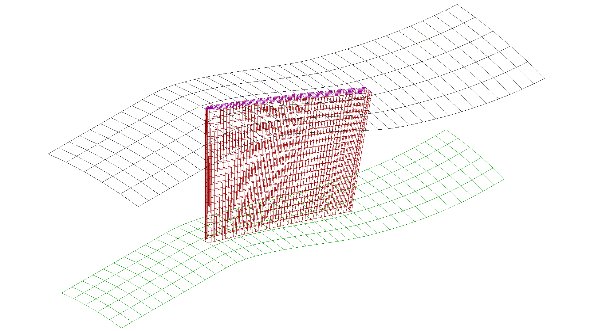
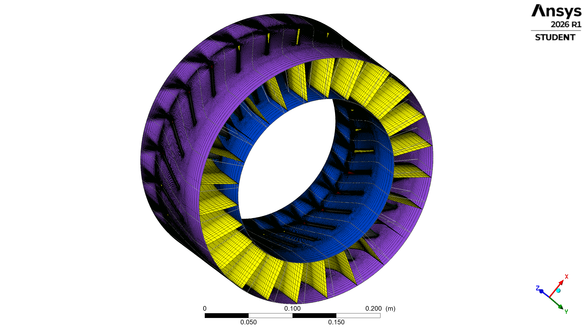
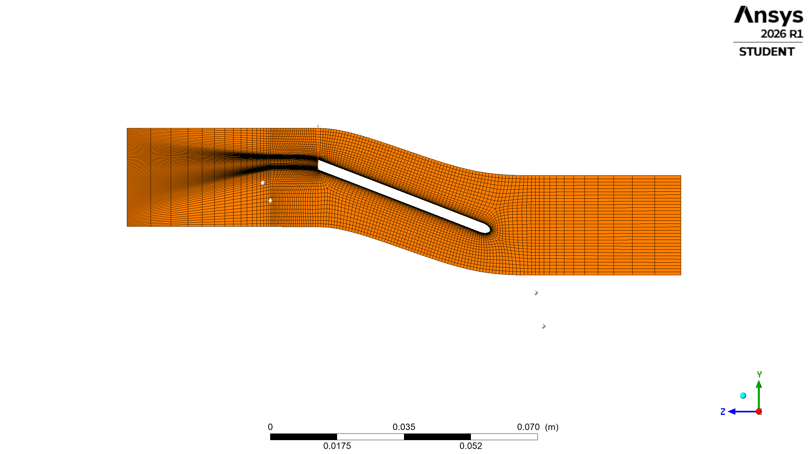
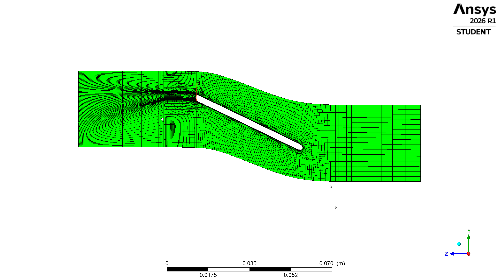
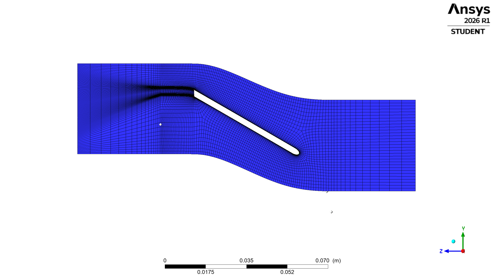
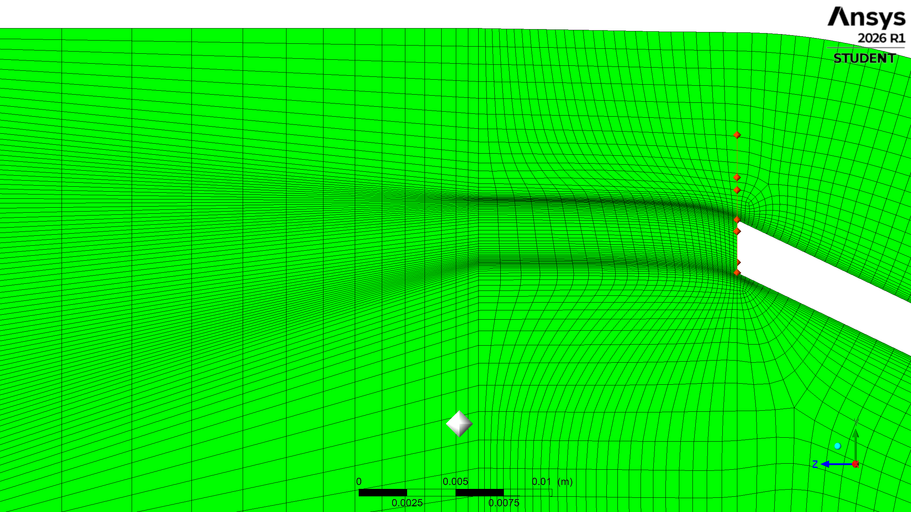
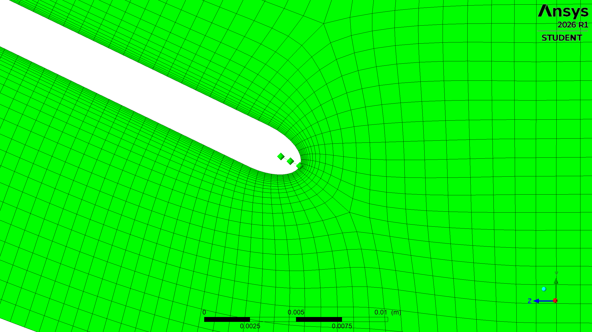

# Axial Compressor Rotor Modeling & Meshing

**Structured Blade-Passage Meshing and Geometric Mesh-Quality Assessment Using ANSYS BladeGen, TurboGrid, and Python**

This educational project develops an axial compressor rotor blade geometry, generates a structured hexahedral mesh for a single periodic blade passage, and evaluates five meshing configurations.

The study focuses on geometric mesh quality, meshing parameter sensitivity, and automated statistical data extraction.

**Scope:** Geometry modeling and mesh-quality optimization. No CFD flow solution or mesh-independence study is claimed.

---

## 1. Project Overview

The workflow consists of four main stages:

1. **Geometry Modeling:** Define the meridional flow path, blade-angle distribution, and thickness distribution using ANSYS BladeGen.
2. **Mesh Generation:** Transfer the blade geometry to ANSYS TurboGrid and generate a structured hexahedral mesh using Automatic Topology and Meshing (ATM).
3. **Mesh Quality Assessment:** Evaluate the mesh using TurboGrid quality statistics and configured quality limits.
4. **Parameter Study and Automation:** Modify selected meshing parameters, regenerate the mesh, and extract comparative statistics using PyTurboGrid.

### Software Environment

| Software / Tool | Version / Role |
|---|---|
| ANSYS Workbench | 2026 R1 Student |
| ANSYS BladeGen | 2026 R1 |
| ANSYS TurboGrid | 2026 R1 |
| Python | 3.11 |
| PyTurboGrid (`ansys-turbogrid-core`) | 0.9.4 |
| Microsoft Excel | Mesh-quality comparison |

---

## 2. Rotor Geometry

The initial axial compressor rotor geometry was created using ANSYS BladeGen.

### Geometric Parameters

| Parameter | Value |
|---|---:|
| Machine type | Axial Compressor Rotor |
| Number of rotor blades | 24 |
| Hub radius | 100 mm |
| Shroud radius | 150 mm |
| Blade span | 50 mm |
| Blade axial extent | 45 mm |
| Angular pitch | 15° |

The geometry was developed as an illustrative configuration for learning and evaluating the blade modeling and meshing workflow.

Aerodynamic performance has not been validated.



*Figure 1. Rotor blade geometry created in ANSYS BladeGen.*

---

## 3. Structured Mesh Generation

ANSYS TurboGrid was used to generate a structured hexahedral mesh for a single blade-to-blade flow passage.

The computational domain includes the inlet, outlet, and blade-passage regions.

Automatic Topology and Meshing (ATM) was used to construct the mesh topology and control the mesh distribution.

### 3.1. Baseline Mesh

| Mesh Quantity | Value |
|---|---:|
| Total Nodes | 223,857 |
| Total Elements | 205,244 |
| Mesh Type | Structured Hexahedral |
| Computational Domain | Single Blade Passage |
| Meshing Software | ANSYS TurboGrid 2026 R1 |



*Figure 2. Three-dimensional structured blade-passage mesh generated in TurboGrid.*

### 3.2. Mesh Cross-Sections

The mesh was examined at three spanwise locations to assess its distribution across the blade height.

| Hub | Midspan | Tip |
|---|---|---|
|  |  |  |

*Figure 3. Blade-to-blade mesh sections near the hub, midspan, and tip.*

### 3.3. Local Mesh Structure

Additional visual inspections were performed around the leading edge (LE) and trailing edge (TE).

These regions are important because blade curvature and local geometric constraints can influence element shape and mesh distribution.

| Leading Edge | Trailing Edge |
|---|---|
|  |  |

*Figure 4. Local structured mesh distributions around the leading and trailing edges.*

---

## 4. Mesh Quality Assessment

Mesh quality was evaluated using the following geometric metrics:

- Orthogonality Angle
- Minimum Face Angle
- Maximum Face Angle
- Edge Length Ratio
- Element Volume Ratio
- Minimum Volume
- Connectivity Number
- Skewness

The analysis was performed for all mesh domains using TurboGrid Mesh Statistics.

### 4.1. Baseline Mesh Statistics

| Mesh Quality Metric | Baseline Value |
|---|---:|
| Orthogonality Angle | 37.9389° |
| Minimum Face Angle | 35.1806° |
| Maximum Face Angle | 144.737° |
| Maximum Edge Length Ratio | 200.302 |
| Maximum Element Volume Ratio | 4.50705 |
| Minimum Element Volume | 2.89777 × 10⁻¹³ m³ |
| Maximum Connectivity Number | 10 |
| Maximum Skewness | 0.609138 |

Angles and volume are expressed in degrees and cubic meters in this table. The exported PyTurboGrid CSV files may contain values in radians and cubic centimeters.

### 4.2. Mesh Quality Classification

TurboGrid classifies elements according to the configured mesh-quality limits:

- **% Bad:** Percentage classified as unacceptable.
- **% ok:** Percentage in the intermediate quality category.
- **% OK:** Percentage satisfying the preferred quality range.

All five configurations reported **0% Bad** across the evaluated metrics under the configured TurboGrid limits.

This result indicates that the generated meshes satisfy the selected geometric quality limits. It does not establish CFD accuracy or numerical mesh independence.

---

## 5. Meshing Parameter Study

A parameter study was conducted to investigate the influence of selected mesh-generation settings on geometric mesh quality.

Five configurations were evaluated:

- Baseline
- Run 1
- Run 2
- Run 3
- Run 4

Each experimental run modifies one parameter relative to the baseline configuration.

### 5.1. Experimental Configurations

| Configuration | Spanwise-to-B2B Count Factor | Boundary-Layer Factor Base | Target Maximum Expansion Rate |
|---|---:|---:|---:|
| Baseline | 1.00 | 3.0 | 1.30 |
| Run 1 | 1.15 | 3.0 | 1.30 |
| Run 2 | 1.30 | 3.0 | 1.30 |
| Run 3 | 1.00 | 3.3 | 1.30 |
| Run 4 | 1.00 | 3.0 | 1.25 |

The spanwise-to-blade-to-blade count factor controls the relative mesh resolution in the spanwise direction.

The boundary-layer factor base affects refinement near solid surfaces.

The target maximum expansion rate influences the intended growth rate of neighboring mesh elements.

### 5.2. Comparative Mesh Quality Results

The following statistics were extracted from the five TurboGrid configurations.

| Configuration | Orthogonality (% ok) | Connectivity (% ok) | Maximum Edge Length Ratio |
|---|---:|---:|---:|
| Baseline | 0.327441% | 0.044671% | 200.302 |
| Run 1 | 0.309938% | 0.045321% | 171.599 |
| Run 2 | **0.297913%** | 0.045833% | **137.487** |
| Run 3 | 0.305818% | **0.043440%** | 232.031 |
| Run 4 | 0.335912% | 0.045640% | 201.512 |

### 5.3. Results and Discussion

**Run 1 — Increased Spanwise Resolution**

Increasing the spanwise-to-B2B count factor from 1.00 to 1.15 reduced the intermediate-category orthogonality percentage and maximum Edge Length Ratio.

**Run 2 — Further Increased Spanwise Resolution**

Increasing the spanwise-to-B2B count factor to 1.30 produced the lowest intermediate-category orthogonality percentage and the lowest maximum Edge Length Ratio among the five configurations.

Relative to the baseline:

- Orthogonality `% ok` decreased by approximately 9.0%.
- Maximum Edge Length Ratio decreased by approximately 31.4%.

However, the intermediate-category Connectivity percentage increased slightly.

**Run 3 — Boundary-Layer Refinement**

Increasing the boundary-layer factor base from 3.0 to 3.3 produced the lowest intermediate-category Connectivity percentage.

However, the maximum Edge Length Ratio increased from 200.302 to 232.031.

**Run 4 — Reduced Expansion Rate**

Reducing the target maximum expansion rate from 1.30 to 1.25 did not improve the intermediate-category Orthogonality or Connectivity percentages relative to the baseline.

### 5.4. Interpretation

Among the evaluated configurations, Run 2 provides the most favorable results for the selected Orthogonality classification and maximum Edge Length Ratio.

Run 3 produces the lowest intermediate-category Connectivity percentage.

These observations indicate that meshing parameters can affect different quality metrics in different ways.

The results do not establish a universally optimal mesh.

A more complete optimization would also consider the number of elements, computational cost, local mesh-quality distributions, and CFD solution convergence.

The complete statistical results and Excel comparison workbook are available in the [`results/`](results/) directory.

[Download Mesh Quality Comparison Workbook](results/Axial_Compressor_Rotor_mesh_quality_comparison.xlsx)

---

## 6. Python Automation

PyTurboGrid was used to automate mesh generation and mesh-quality statistics extraction.

The automated workflow consists of:

1. Load a TurboGrid state file.
2. Generate the mesh.
3. Extract mesh-quality statistics.
4. Export the statistics to CSV.
5. Repeat for all available mesh configurations.

The Python scripts are stored in [`scripts/`](scripts/).

### 6.1. Requirements

The following environment was used:

- ANSYS TurboGrid 2026 R1
- Python 3.11
- PyTurboGrid 0.9.4
- A compatible ANSYS license

TurboGrid must be installed locally.

### 6.2. Installation

Clone or download this repository and open PowerShell in the repository root directory.

Install the required Python dependency:

```powershell
python -m pip install -r requirements.txt
```

### 6.3. Running the Analysis

Run the mesh statistics extraction script:

```powershell
python scripts/export_stats.py
```

The script automatically searches the `states/` directory for `.tst` files, processes each configuration, and writes the resulting CSV files to `results/`.

### 6.4. Reproducibility Verification

**Verification Date:** November 11, 2026

A reproducibility execution test was performed by downloading the repository from GitHub into a separate directory on the original Windows workstation.

**Test Environment**

| Component | Configuration |
|---|---|
| Operating System | Windows |
| ANSYS TurboGrid | 2026 R1 Student |
| Python | 3.11 |
| PyTurboGrid | 0.9.4 |
| Source | Fresh GitHub repository download |

**Verification Procedure**

1. Download the repository from GitHub.
2. Extract the project into a separate directory.
3. Open PowerShell in the repository root directory.
4. Install the dependencies from `requirements.txt`.
5. Execute `python scripts/export_stats.py`.
6. Check the output files in `results/`.

**Execution Results**

| Configuration | Execution Status |
|---|---|
| Baseline | SUCCESS |
| Run 1 | SUCCESS |
| Run 2 | SUCCESS |
| Run 3 | SUCCESS |
| Run 4 | SUCCESS |

The script reported:

```text
Found 5 state files

Processing: Baseline.tst
SUCCESS

Processing: Run1_PassageFactor115_stats.tst
SUCCESS

Processing: Run2_PassageFactor130_stats.tst
SUCCESS

Processing: Run3_FactorBase330_stats.tst
SUCCESS

Processing: Run4_ExpansionRate125_stats.tst
SUCCESS

All available states processed.
```

All five TurboGrid configurations were processed successfully, and five mesh-statistics CSV files were regenerated.

**Verification Scope**

This test confirms successful execution of the automated mesh-generation and statistics-export workflow from a fresh repository download on the original workstation.

Numerical equivalence between the regenerated CSV files and the committed reference results has not yet been independently verified.

Reproduction on a different workstation has not yet been tested.

Some `.tst` state files contain absolute geometry paths from the original workstation. Geometry references may need to be relinked when reproducing the project in another environment.

The required `.curve` and `.inf` geometry-support files are included in the `states/` directory.

---

## 7. Repository Structure

```text
axial-compressor-rotor-modeling-meshing/
│
├── README.md
├── .gitignore
├── requirements.txt
├── Axial_Compressor_Rotor_technical_report.pdf
│
├── geometry/
│   └── BG.bgd
│
├── states/
│   ├── BG.inf
│   ├── BG_hub.curve
│   ├── BG_profile.curve
│   ├── BG_shroud.curve
│   ├── Baseline.tst
│   └── Run1-Run4 state files
│
├── scripts/
│   ├── export_baseline.py
│   └── export_stats.py
│
├── results/
│   ├── Baseline_stats.csv
│   ├── Run1-Run4 statistics CSV files
│   └── Axial_Compressor_Rotor_mesh_quality_comparison.xlsx
│
└── figures/
    ├── rotor_3d.png
    ├── mesh_3d.png
    ├── mesh_hub.png
    ├── mesh_midspan.png
    ├── mesh_tip.png
    ├── mesh_le.png
    └── mesh_te.png
```

---

## 8. Limitations and Future Work

This project focuses on geometric modeling, structured mesh generation, and mesh-quality assessment.

The following analyses have not been performed:

- CFD flow simulation using ANSYS CFX or Fluent.
- Compressor pressure-ratio calculation.
- Aerodynamic efficiency prediction.
- Near-wall resolution verification for a specified operating condition.
- CFD-based mesh-independence analysis.
- Independent reproducibility verification on another workstation.

Potential future developments include:

1. Extracting node and element counts for each mesh configuration.
2. Comparing mesh quality against mesh resolution and computational cost.
3. Investigating local mesh-quality distributions near the blade surfaces.
4. Performing CFD simulations using ANSYS CFX or Fluent.
5. Conducting a CFD-based grid-convergence study.

---

## 9. Technical Report

A technical report has been prepared to document the rotor geometry, structured mesh generation methodology, mesh-quality statistics, parametric study, and principal conclusions.

**[Download Technical Report (PDF)](Axial_Compressor_Rotor_technical_report.pdf)**

---

## 10. Conclusion

A simplified axial compressor rotor blade was modeled using ANSYS BladeGen, and a structured hexahedral mesh was generated for a single blade passage using ANSYS TurboGrid.

Five meshing configurations were evaluated to investigate the influence of selected mesh-generation parameters on geometric mesh-quality metrics.

All five configurations satisfied the configured TurboGrid quality limits without elements classified as Bad.

Run 2 achieved the lowest intermediate-category Orthogonality percentage and the lowest maximum Edge Length Ratio among the evaluated configurations.

PyTurboGrid was successfully used to automate mesh generation and statistical data extraction. The complete five-run workflow was also executed successfully from a fresh repository download on the original workstation.

The project demonstrates an integrated engineering workflow combining geometry modeling, structured meshing, mesh-quality analysis, parameter studies, and Python-based automation.

The results provide a foundation for subsequent CFD simulation and numerical grid-convergence investigations.
